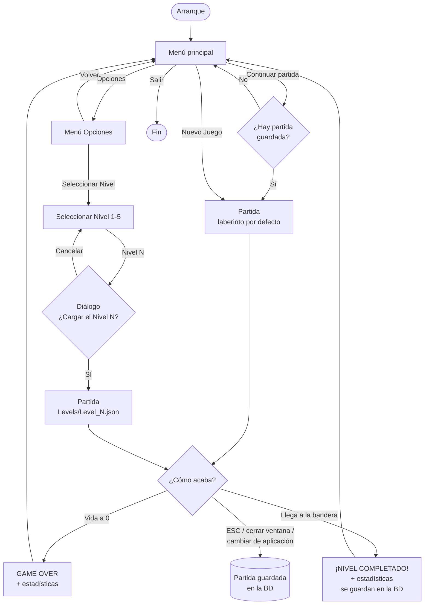
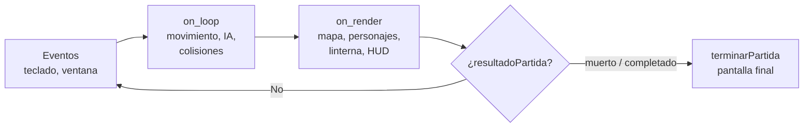
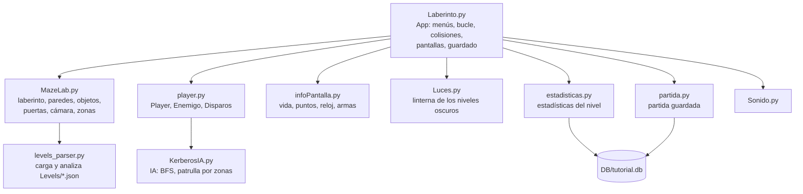

# LaberintoPython

Juego de laberinto en Python con la librería [pygame](https://www.pygame.org): recorres el laberinto,
recoges huesos y monedas, esquivas o abates a los enemigos y al jefe, y llegas a la bandera de salida.

---

## Cómo ejecutarlo

### Requisitos
- **Python 3.11** (pygame 2.6.1 no tiene paquetes precompilados para Python 3.14).
- Las dependencias de [`requirements.txt`](requirements.txt): `pygame`, `plyer` (notificaciones), `pyobjus` (lo usa `plyer` en macOS) y `pytest` (tests).

### Instalación (una sola vez)
```bash
python3.11 -m venv venv2
```
```bash
venv2/bin/python -m pip install -r requirements.txt
```

### Jugar
```bash
venv2/bin/python Code/Laberinto.py
```
Funciona igual lanzándolo desde la raíz del proyecto, desde `Code/` o desde PyCharm: al arrancar, el juego
se sitúa en la raíz del proyecto para encontrar `Resources/`, `Levels/`, `DB/` y `log/`.

### Tests
```bash
venv2/bin/python -m pytest
```
Los tests se ejecutan sin ventana ni sonido (drivers `dummy` de SDL), no lanzan notificaciones y nunca
escriben en la base de datos real.

### Informe de los niveles
```bash
venv2/bin/python Code/levels_parser.py
```
Comprueba si cada nivel de `Levels/` tiene sentido: borde cerrado, inicio sobre suelo, todo el suelo
alcanzable, objetos sobre suelo, una salida, niveles repetidos…

---

## Controles

| Tecla | Acción |
|---|---|
| ← ↑ → ↓ | Mover al jugador |
| ESPACIO | Disparar |
| P | Pausa |
| S | Música on/off |
| ESC | Guardar la partida y salir |

Teclas de depuración: `C` rectángulos de colisión, `K` número de cada casilla, `D` abrir/cerrar puertas,
`INTRO` alarma del jefe y disparo de los enemigos, `X` explosión de prueba, `Z` humo de prueba,
`V` cono de visión (todavía sin efecto).

---

## Esquema del juego

### Pantallas



### Bucle de una partida (`App.on_execute`)



Cada frame (60 FPS):
1. **Eventos**: flechas, disparo, pausa… Si la ventana pierde el foco, se minimiza o la app pasa a segundo
   plano (iOS/Android), la partida se guarda.
2. **`on_loop`**: mueve al jugador y a los enemigos y resuelve las colisiones (paredes, puertas, enemigos,
   balas, objetos, bandera de salida). Aquí se suman las estadísticas.
3. **`on_render`**: pinta el laberinto, los objetos, los personajes, la oscuridad y la linterna (niveles
   oscuros) y el HUD (vida, puntos, reloj, nivel, huesos, munición).
4. Si el jugador ha muerto o ha llegado a la salida, se muestra la pantalla final y se vuelve al menú.

### Módulos



| Fichero | Qué hace |
|---|---|
| [`Code/Laberinto.py`](Code/Laberinto.py) | Programa principal (`App`): menús, diálogo de confirmación, bucle del juego, colisiones, combate, pantallas de fin, guardar y continuar partida. |
| [`Code/MazeLab.py`](Code/MazeLab.py) | `Maze`: el laberinto (por defecto o cargado de un JSON), paredes, objetos, puertas, cámara, conexiones entre casillas y zonas (habitaciones, pasillos y cruces). También `Explosion`, `Smoke` y `Puerta`. |
| [`Code/player.py`](Code/player.py) | `Player` (jugador), `Enemigo` (enemigos normales y jefe) y `Disparos` (balas). |
| [`Code/KerberosIA.py`](Code/KerberosIA.py) | IA de los enemigos: camino más corto (BFS) para el jefe y patrulla por zonas para los enemigos normales. |
| [`Code/levels_parser.py`](Code/levels_parser.py) | Lee los niveles JSON y analiza si tienen sentido. |
| [`Code/Luces.py`](Code/Luces.py) | `Linterna`: oscuridad y haz de luz que no atraviesa paredes, enemigos ni puertas. |
| [`Code/estadisticas.py`](Code/estadisticas.py) | `Estadisticas` del nivel: se muestran al acabar y se guardan si se completa. |
| [`Code/partida.py`](Code/partida.py) | `PartidaGuardada`: guarda, carga y borra la partida en curso. |
| [`Code/infoPantalla.py`](Code/infoPantalla.py) | Elementos del HUD: barra de vida, puntuación, reloj, nivel, huesos, armas. |
| [`Code/Sonido.py`](Code/Sonido.py), [`Code/mates.py`](Code/mates.py) | Sonido y utilidades (¿está el ratón dentro de un botón?). |

---

## Reglas

| | |
|---|---|
| Vida inicial | 60 |
| Tocar a un enemigo / al jefe | −10 / −20 de vida |
| Bala enemiga | −10 de vida |
| Tras una herida | 1 s sin recibir otra |
| Balas para matar | 2 a un enemigo (+50 puntos), 4 al jefe (+200 puntos) |
| Hueso / pila de huesos | +10 puntos / +50 puntos y 10 huesos |
| Moneda de oro | +100 puntos |
| Botiquín | +30 de vida |
| Vida a 0 | GAME OVER |
| Tocar la bandera de salida | Nivel completado |

Los valores de combate son constantes al principio de `Laberinto.py` (`DANO_ENEMIGO`, `DANO_BALA_JUGADOR`,
`VIDA_JEFE`…).

### Enemigos
- **Enemigos normales**: patrullan la zona en la que empiezan. En una **habitación** (zona amplia) se mueven
  por ella sin salir; en un **pasillo** (zona de una casilla de ancho) lo recorren de un extremo a otro y
  dan media vuelta.
- **Jefe**: patrulla todo el laberinto. Si tocas a un enemigo o al propio jefe, te persigue por el camino
  más corto (BFS) y los enemigos dan la voz de alarma con un bocadillo.

### Estadísticas de fin de nivel
Debajo de GAME OVER o de ¡NIVEL COMPLETADO! se muestran: enemigos muertos, balas usadas, acierto en
disparos (muertes / balas, en %), huesos, monedas de oro, tiempo y heridas recibidas.
**Sólo se guardan en la base de datos si completas el nivel.**

### Partida guardada
La partida se guarda al pulsar ESC, al cerrar la ventana y al cambiar de aplicación (la ventana pierde el
foco o se minimiza, o la app pasa a segundo plano en iOS/Android). Se guarda todo: nivel, posición,
vida, objetos cogidos, enemigos vivos y muertos, estadísticas y tiempo. Se continúa con
**Continuar partida** en el menú principal. Al terminar el nivel (morir o completarlo) se borra.

---

## Niveles (`Levels/Level_N.json`)

El botón *Nivel N* de **Opciones → Seleccionar Nivel** carga `Levels/Level_N.json`. Ejemplo (con las
capas recortadas a 3×2 para que se lea; en el fichero real tienen `width` × `height` casillas):

```json
{
  "tileNames": ["Floor", "Wall", "Bone", "DogDown1", "Exit"],
  "width": 27, "height": 27,
  "tileWidth": 32, "tileHeight": 32,
  "playerSpawnX": 25, "playerSpawnY": 1,
  "oscuridad": 0.9,
  "layers": [
    {"name": "Background", "tiles": [[2, 2, 2], [2, 1, 2]]},
    {"name": "Objects",    "tiles": [[0, 0, 0], [0, 3, 0]]}
  ]
}
```

- Los números de `tiles` son la posición en `tileNames` **empezando en 1** (0 = vacío):
  1 `Floor` suelo, 2 `Wall` pared, 3 `Bone` hueso, 4 `DogDown1` posición de enemigo, 5 `Exit` salida.
- `Background`: suelo y paredes. `Objects`: huesos, posibles posiciones de enemigos y la salida.
- `playerSpawnX/Y`: casilla de inicio del jugador (columna, fila).
- `oscuridad` (opcional, 0-1): nivel oscuro; sólo se ve el haz de la linterna. `Level_2` es oscuro (90 %).
- Tamaño máximo: 40×27 casillas. Si cabe, el nivel se rodea de un marco de paredes.

---

## Base de datos (`DB/tutorial.db`)

| Tabla | Contenido |
|---|---|
| `estadisticas_nivel` | Una fila por nivel completado: fecha, jugador, nivel, enemigos muertos, balas, impactos, % de acierto, huesos, oro, tiempo, heridas, vida perdida y puntos. |
| `partida_guardada` | La partida en curso de cada jugador (una por jugador). El estado completo va en JSON en la columna `estado`. |
| `partida`, `estadisticas` | Tablas antiguas, vacías y sin usar. |

Las tablas nuevas se crean solas la primera vez que se necesitan.

---

## Estructura de carpetas

```
LaberintoPython/
├── Code/             código del juego (Laberinto.py es el programa principal)
│   ├── assets/       imágenes de disparos, explosiones y humo
│   └── Pruebas/      prototipos y ejemplos sueltos (no forman parte del juego)
├── Levels/           niveles en JSON
├── Resources/        imágenes, iconos y sonidos
├── DB/tutorial.db    base de datos SQLite
├── log/              registro del juego (squidcastle.log), se crea al arrancar
├── tests/            tests de pytest
├── Historico-SVN/    versiones antiguas
├── requirements.txt
└── pytest.ini
```
